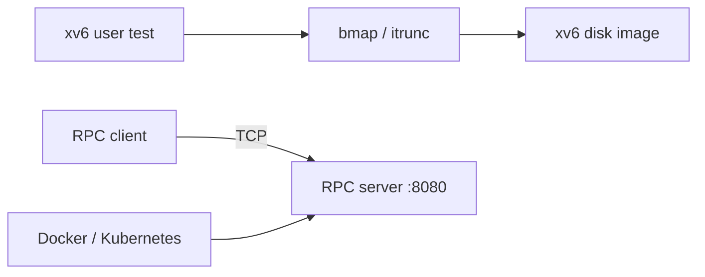

# xv6 File System Extension & Edge RPC

Double-indirect block addressing, TCP RPC and resource-constrained container deployment.

[Project website](index.html) · [Technical report](docs/project-report.docx) · [Presentation](docs/presentation.pptx) · [Implementation guide](docs/implementation.md) · [Results](results/results.csv)

## Interactive website

Open `index.html` locally, or enable GitHub Pages from `main` / root. The site combines the 3D storage model, block-addressing explorer, reclamation simulator, RPC playground, implementation walkthrough, results and original documents. All interactions are browser-only educational models.

## Results

| Metric | Baseline | Extended |
|---|---:|---:|
| Direct blocks | 12 | 11 |
| Single-indirect blocks | 128 | 128 |
| Double-indirect blocks | 0 | 16,384 |
| Addressable data blocks | 140 | 16,523 |
| Maximum bytes | 71,680 | 8,459,776 |
| On-disk inode | 64 bytes | 64 bytes |

Capacity increased 118.02× under the reported 512-byte block configuration. The report records 600 blocks written and verified with zero mismatches, successful unlink without reported panic or leak, all three RPC operations successful, and a 448 KiB container memory observation against a 128 MiB limit. These are reported results, not independently rerun tests. Maximum capacity is calculated, not stress-tested to its limit.

## Architecture

The RPC write operation is simulated; no direct bridge to the xv6 disk image was verified.

## Reproduce

See the [implementation guide](docs/implementation.md). This is a documentation repository prepared from the supplied report and slides. The original kernel tree, RPC source, Dockerfile, manifests and raw test logs were not supplied. Add the original files before attempting to build. No upstream revision or exact build command is known.

## Contributors

- Nikhil Maan — kernel modifications and file-system engineering
- Mohd Faiz — socket RPC and automated testing
- Sonu Kumar Rai — containerization, Kubernetes and documentation

Bennett University · M.Tech CSE · Advanced Operating Systems (2026CSAE603) · Group 1 · November 2026. Facilitator: Dr. Prabhat Kumar Bharti.

## Limitations and future work

Native C RPC structures are not a portable wire protocol. Authentication, encryption, timeouts, concurrency and sustained performance are not established. Future work includes a real kernel bridge, explicit framing and byte order, and full-capacity and repeated reclamation tests. No license is assigned to this package; verify permissions and retain upstream xv6 licensing when adding source. Original academic documents contain enrollment numbers; review before public release.
